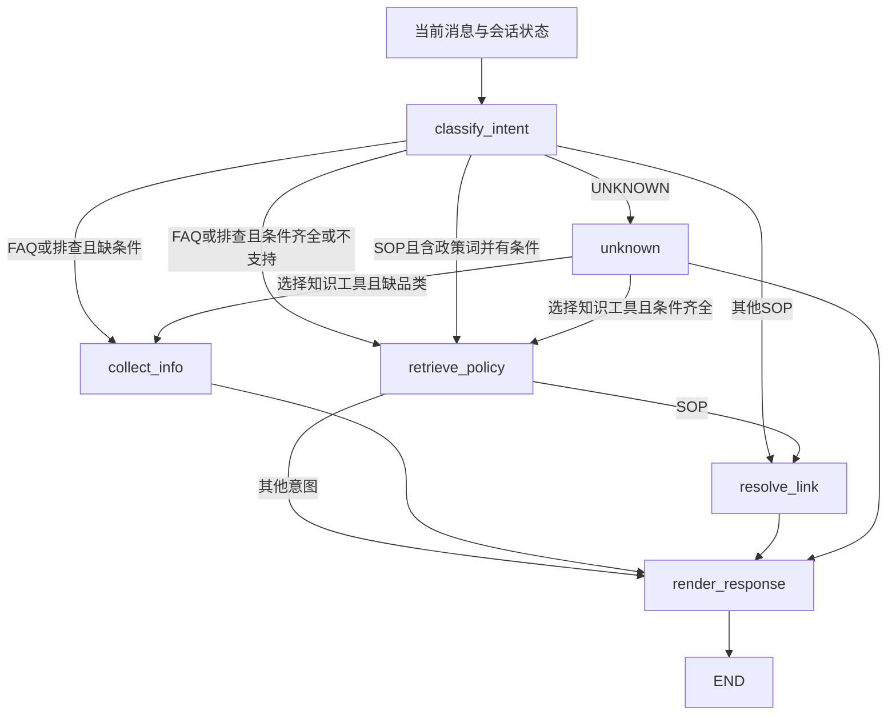

# GlobalCare 商品与售后咨询 Agent 技术方案

> 核对日期：2026-10-15。基线：HEAD `2f789ac` 加当前工作区未提交改动，行为以源码为准。
> 本版按当前实现整理，移除旧政策向量库、维修受理草稿及其接口的历史实施章节。历史版本可从 Git 查阅，不能作为当前运行契约。
> 本版包含真实运行链路改造、知识初始化与网页核验。执行证据见[测试说明与报告](测试说明与报告.md)；正式资料、公司业务与生产部署未据此认定已完成。

## 1. 当前目标与范围

GlobalCare 是商品与售后咨询 Agent，提供保修政策、故障排查和官方入口引导。仅服务中国大陆，`market` 内部固定 CN。

- FAQ/排查：定位受控 FAQ 条目，取适用品类与渠道的政策条款，附标题、版本和引用。
- 购买：返回配置的官网商城 URL。
- 售后申请/维修进度：返回售后入口，由客户在官方页面申请或查询。
- 无法识别：`UNKNOWN` 进入受控 Agent，结合最近 50 轮对话选择 `search_knowledge` 或直接澄清/回应；`CHITCHAT` 由无工具 LLM 自然回复。
- 无适用答案：说明无法可靠给出政策结论，提示联系官方客服。

当前不创建受理草稿、正式 Case 或 Work Order，不代填/提交，不查个人订单、设备和实时维修进度，没有人工坐席接管或审批流程。独立只读 MCP 模块保留，但不是当前聊天运行依赖。

政策资料和 FAQ 目录为模拟样例，尚无正式品牌政策、入口和真实订单关联验收。

## 2. 已实现与后续设计

| 项目 | 当前源码 | 后续设计 |
| --- | --- | --- |
| 政策条件来源 | 网页/API、文本和会话状态；渠道缺省为商城，仅追问缺失品类 | 从可信业务上下文自动关联订单、品类、渠道和政策 |
| 路由 | L0 规则、L1 精确匹配、L2 检索、L3 分类/UNKNOWN | 用正式业务语料评估并维护意图和阈值 |
| 知识单元 | FAQ 问法与政策单条款答案变体 | 长文档父子分块与同版本父章节回查 |
| 检索 | dense COSINE、按 ID 聚合、最低分与分差门禁 | dense+sparse、RRF、可选独立重排 |
| 最终回复 | 政策原文与固定模板；闲聊和 UNKNOWN 的直接回应由 LLM 生成 | 业务答案的证据约束生成、引用和事实核验 |
| 商品知识 | 250 条模拟资料保存在演示目录，未接入 | 独立接入商品/使用知识类型 |
| 入口 | 应用读取固定 HTTPS URL | 正式业务配置与治理 |
| 知识发布 | 从目录构建，seed 重建演示索引 | 配套知识运营、审批、版本失效与发布治理 |

最新 PPT 中的企业整体架构、Neo4j、推荐、质检、培训、混合检索和订单自动关联不自动归为本项目已交付能力。相关规划继续保留在[完整 RAG 设计](docs/design/ecommerce-rag-20261013/技术方案-详细实现版.md)；业务口径缺口见[SDD 缺口清单](SDD缺口清单.md)。

## 3. 组件与运行架构

```text
浏览器 Vue 3（POST + fetch 消费 SSE）
  → FastAPI main.py（鉴权、DTO、会话归属、readiness）
    → ConversationService（会话锁、幂等、状态、审计、保存结果）
      → LangGraph 六节点图
        ├─ KnowledgeStore
        │   ├─ Redis：精确索引、版本指针、答案变体
        │   └─ Milvus：intent_corpus / faq_question
        ├─ AgentModel：按需消解最近 50 轮指代、L3 结构化分类
        └─ 应用配置：商城 / 售后 URL

会话 Store：InMemoryStore 或 PostgresStore
图 checkpoint：MemorySaver 或 AsyncPostgresSaver

独立 MCP server → MockBusinessGateway / HttpBusinessGateway
（聊天图没有连接此分支）
```

| 组件 | 代码 | 职责 |
| --- | --- | --- |
| 网页 | [frontend/index.html](frontend/index.html) | 品类/渠道选择、聊天、进度、证据和链接 |
| API | [main.py](agent_service/app/main.py) | 装配和接口 |
| 会话服务 | [service.py](agent_service/app/service.py) | 串行、预算外围、幂等、SSE、持久化 |
| 图 | [graph.py](agent_service/app/graph.py) | 分流、追问、FAQ、入口、兜底、回复 |
| 知识端口 | [knowledge_base.py](agent_service/app/knowledge_base.py) | `KnowledgeStore`、Embedding、检索、答案审查 |
| 知识目录 | [faq_catalog.py](agent_service/app/faq_catalog.py) | 生成同源内存/Milvus/Redis 数据 |
| 规则与模型 | [intent.py](agent_service/app/intent.py)、[model_factory.py](agent_service/app/model_factory.py) | 分类、否定识别、字段抽取 |
| 会话存储 | [store.py](agent_service/app/store.py)、[postgres_store.py](agent_service/app/postgres_store.py) | 消息、状态、引用、入口、指纹、结果与审计 |
| 图状态存储 | [checkpointer.py](agent_service/app/checkpointer.py) | 图 checkpoint，独立于会话 Store |
| 只读工具 | [mcp_server.py](agent_service/mcp_server.py)、[business.py](agent_service/app/business.py) | 保留的独立业务查询能力 |

当前工作区没有 `domain_service/`，不将历史 Java 服务与 Maven 验证列为当前可执行交付。HTTP 网关可配置远端模拟/业务服务，是否可用需另行验证。

## 4. 四层路由的实际顺序

`route_turn` 先检查上一轮 FAQ 候选序号；有效选择直接确定 FAQ 条目。普通新问题按下列顺序处理，命中即返回：

1. **L0 SOP 规则**：确定性 `classify_intent` 命中购买、售后或维修进度，且没有否定办理，直接路由。
2. **L0 不支持范围**：命中高风险政策/非支持产品词，路由 FAQ，后续检索拒答。
3. **L1 精确匹配**：归一化问句后用 SHA-256 hash 查 Redis，取得 `intent_id / faq_group_id / faq_item_id`。
4. **L2 意图检索**：Milvus `intent_corpus` 召回，按 `intent_id` 取各意图最高分，检查最低分和第一、第二意图分差，再用目录映射 SOP/FAQ 与 FAQ 组。
5. **FAQ 规则方向补充**：L2 未确定但规则识别为 FAQ/排查，沿该方向进入 FAQ 检索；条目仍需检索及适用性检查。
6. **L3 分类**：调用 `AgentModel.classify`；无法确定或不允许的否定入口判定，转为 `UNKNOWN`。

路由状态保存 `route_layer`、`intent`、`route_target`、`faq_group_id`、`faq_item_id` 和 `route_score`。

`L0_RULE` 也可能只是 FAQ 方向：它不表示已经取得答案。L1 已定位条目时仍要补齐适用条件并读取/复核答案。L3 识别出 FAQ 时也必须走知识端口，不由模型自由回答。

## 5. LangGraph 六节点与条件边

| 节点 | 行为 |
| --- | --- |
| `classify_intent` | 抽取品类/渠道/型号；判断续接或四层路由；清理本轮输出 |
| `collect_info` | FAQ/排查缺品类时追问 goodsid，返回 CLARIFICATION；不追问渠道 |
| `retrieve_policy` | 定位 FAQ、读取答案变体、适用性复核、候选澄清或无证据提示 |
| `resolve_link` | 读取固定 URL，输出链接或入口未配置说明 |
| `unknown` | UNKNOWN 由 Agent 选择知识工具或直接回应；CHITCHAT 由无工具 LLM 回复 |
| `render_response` | 政策原文/提示与入口话术，写入助手消息和会话状态 |



没有个人业务查询或写入节点。CHITCHAT 和 UNKNOWN 共用 unknown 节点，前者调用无工具 LLM，后者使用绑定知识工具的单次决策 Agent。

### UNKNOWN 的只读知识工具

Agent 通过原生 tool calling 选择 `search_knowledge(question, goodsid?, sales_channel?)`，参数经 Pydantic 校验：问题非空且最长 2000 字符，品类和渠道采用已有白名单，禁止额外字段。显式文本条件优先，模型候选其次，再沿用会话条件；渠道缺省为商城。缺少品类先追问，补齐后执行。工具调用重用 retrieve_policy 节点中的 KnowledgeStore 精确匹配、语义检索、答案适用性审查，不新增知识库或 MCP 服务。

每轮最多执行一次知识工具，受 max_tool_calls 配置门禁约束；拒绝未知工具、多工具调用和无效参数。检索结果由应用按原文返回，不进入无限工具循环，不让模型改写政策。工具执行事件及结果沿用已有 SSE、审计和幂等保存链路；相同请求重放不重新执行。服务故障走错误或知识不可用提示，不伪装成功。

闲聊结合最近 50 轮自然回应，不强制转售后话题。当前没有实时天气查询工具，模型不得编造天气、定位、实时价格或个人业务事实。知识答案仍须来自检索，URL 仍只来自已配置入口。mock 的固定回应只用于离线测试。

### 5.1 多轮续接

当前续接要求：上一轮有 missing_fields，或上一轮是 FAQ/故障咨询且保留问题摘要；本轮提供纯品类/渠道条件且未否定办理。满足时沿用旧路由和 issue_summary，并按最新条件重新读取适用答案；完整新问题重新路由。

原阻止词表已移除，购买新问题打断补条件已有用例。页面同步本轮后端范围，避免下一轮条件回退。

指代在现有分类节点内预处理，窗口为当前消息之前最近 50 轮（每轮从一条用户消息开始，包含其后的助手回复）。有指代或省略表达时，模型读取该窗口并返回独立问题、指代对象或澄清问题；明确的新问题不额外调用消解模型。对象必须能在窗口内找到原文，不从更早的 checkpoint、历史消解结果或其他会话补入。无明确对象或有多个候选时先澄清；模型不可用时沿用受限的商品规则，规则同样只读这 50 轮。原始消息保留，补全文本用于路由与检索；审计记录窗口轮数和消解来源。姓名追问只引用窗口内用户明确自述，不写跨会话用户档案，不代表已核验身份。不增加商品参数知识或业务意图。窗口扩大到 50 轮后，模型输入费用、耗时和旧话题干扰可能增加；轮数上限不等于 token 上限，本次不新增摘要或自动压缩机制。

FAQ 分差不足时记录两个 `faq_candidates`，回复标准问题和序号；下一轮选择有效序号可确定条目。追问和候选澄清都会结束本轮，不使用 `interrupt()`。

### 5.2 会话与结果状态

- `conversation_status`：AI_ACTIVE、AI_CANNOT_RESOLVE、COMPLETED、FAILED。
- `result_type`：ANSWER、CLARIFICATION、LINK_GUIDANCE、UNSUPPORTED、CHITCHAT、UNKNOWN。
- `phase`：节点阶段，不等同于会话状态。
- 非人工提示的 `render_response` 通常把会话状态设为 COMPLETED，追问也可能如此；不代表业务问题已解决。
- `human_required` 是提示标记，不是人工分配、审批或已入队。

## 6. FAQ 目录与答案模型

数据源：

- [faq_catalog.yaml](agent_service/data/faq/faq_catalog.yaml)：5 类已配置知识意图语料、FAQ 组与 10 个条目；CHITCHAT 另由规则/模型识别。
- [policies](agent_service/data/policies/)：CN 五品类的商城、自营店、授权店项目政策。
- [faq_catalog.py](agent_service/app/faq_catalog.py)：解析政策列表条款，按 `answer_clause` 合成答案。

问题身份：`intent_id → faq_group_id → faq_item_id`，与品类/渠道分离。

| 条目 | 组 | 政策条款 |
| --- | --- | --- |
| warranty_period | grp_policy | 主机有限保修期 |
| warranty_scope | grp_policy | 适用范围 |
| repair_materials | grp_policy | 申请维修 |
| cannot_power_on | grp_troubleshoot | 无法开机排查 |

答案变体键：`faq_item_id + goodsid + sales_channel + version`。`market` 固定 CN；当前同一品类×渠道只能配置一份政策。没有按 SKU、型号、地区、购买日期选政策，也没有同范围多版本同时生效机制。

政策加载要求正文非空且不超过 4000 字符，CN、品类/渠道白名单、policy_id/title/version/language 完整；严格模式要求非空目录和可用答案。预发/生产还要求源文件 `approved=true` 且非模拟数据。

## 7. Milvus 与 Redis 检索

### 7.1 L1 精确匹配

`normalize_question` 小写化，删除品类/渠道词、部分问候词、标点和空白；`exact_key` 对结果取 SHA-256。

Redis `gc:faq:exact:{hash}` 保存 FAQ 三元组。标准问和已配置相似问都写精确索引；hash 不理解未配置的同义改写。

### 7.2 L2 召回与聚合

| collection | 字段与用途 |
| --- | --- |
| `intent_corpus` | id、intent_id、text、vector；定位意图 |
| `faq_question` | 上述字段及 faq_group_id、faq_item_id、goodsids、sales_channels；定位 FAQ 条目 |

向量用 dense FLOAT_VECTOR、COSINE、AUTOINDEX。单次远端 search 固定 `limit=10`；意图按 intent_id、FAQ 按 faq_item_id 聚合各 ID 的最高分。

FAQ 查询按目录中的组和白名单品类/渠道构造标量过滤；没有组时允许在当前适用范围内检索。值先校验，不把用户原文拼入过滤表达式。对应答案最后还需复核具体品类×渠道组合。

`default_thresholds` 当前值：

| 模式 | 意图最低分 | 意图最小分差 | FAQ 最低分 | FAQ 最小分差 |
| --- | ---: | ---: | ---: | ---: |
| huggingface | 0.72 | 0.03 | 0.62 | 0.02 |
| hash | 0.45 | 0.05 | 0.35 | 0.02 |

意图不满足门槛则继续后续分类；FAQ 分差不足给两个候选，最低分不足则无答案。阈值是源码当前参数，不是正式业务最优值或线上准确率证明。

### 7.3 答案读取与证据

先读取 `gc:faq:version:{item}:{goodsid}:{channel}`，再读 `gc:faq:answer:{item}:{goodsid}:{channel}:{version}`。

`KnowledgeStore.answer` 复核 item、CN、goodsid、channel、答案非空；要求正式资料时还拒绝标记为模拟的答案。源文件审批检查在目录加载阶段执行，不能把它表述为完整远端知识审批平台。

`PolicyEvidence` 包含 policy_id、title、version、market、language、goodsid、sales_channel、excerpt、score、score_kind、retrieval_backend、faq_item_id、degraded。excerpt 是选中条款，不是整份政策。

L1 的证据标 `score_kind=exact_match`；其余默认 cosine_similarity，但部分路由/候选选择使用默认分数，不宜把每个 score 都当作一次实测向量相似度，更不能当事实正确概率。

### 7.4 Embedding 与降级

代码默认 hash、1024 维，仅用于确定性离线测试；语义模式默认 `BAAI/bge-m3`，HuggingFace 初始化固定 `device=cpu`、归一化向量。

memory 后端使用同源目录和进程内余弦索引，模拟 L1/L2/答案读取。milvus 后端初始化检查 Redis 元信息的 Embedding 签名和两个 collection 是否存在。

依赖异常时由 `policy_allow_fallback` 决定是否允许内存降级；严格模式禁止降级。无适用答案进入人工提示；检索节点捕获异常后也进入无可靠答案路径，分类阶段异常则由服务层输出运行错误。

`policy_top_k` 是遗留配置，未被当前 FAQ 查询使用。没有父子切块、稀疏召回、RRF、独立重排和生成式回答。

## 8. 官方入口与模型边界

购买读取 `purchase_url`，售后申请/维修进度读取 `aftersales_url`。非空 URL 必须是无内嵌凭证、有主机名的 HTTPS 地址；是否为正式官方域名由业务配置确认。

URL 为空则输出入口未配置提示，action_links 为空，result_type=UNSUPPORTED。有 URL 时 result_type=LINK_GUIDANCE。

SOP 意图同时含 FAQ 词且品类/渠道齐全时，先检索再给入口；否则直接提供入口，不先追问政策条件。

`AgentModel` 在 minimax 模式通过 LangChain `ChatOpenAI` 请求结构化 `IntentDecision`。失败后尝试普通输出 JSON 兼容解析，再失败回到确定性规则。当前只有 L3 会调用分类方法，前面路由命中可跳过远程请求。

模型单次请求配置 timeout=20、max_retries=0、max_tokens=512；MiniMax-M3 thinking disabled，当前运行禁止规则兜底；兼容调用是显式第二次请求。分类模型接当前问题；指代消解、闲聊和 UNKNOWN Agent 接最近 50 轮对话。直接回应不得为空、超过 2000 字符或包含 URL；严格模式调用失败走运行错误，不伪装成正常回复。最终 render_response 输出政策原文、入口话术或已有 LLM 回应，不再次调用模型。

## 9. API 与 SSE 契约

鉴权支持 `X-Demo-Token` 或 JWT Bearer。JWT 验证 RS256、issuer、audience、有效期和身份字段，会话 Store 验证归属。

| 接口 | 行为 |
| --- | --- |
| POST /api/v1/conversations | 创建 CN 会话，可携带语言、品类、渠道 |
| POST /api/v1/conversations/{id}/messages/stream | 处理消息，返回 SSE |
| GET /api/v1/conversations/{id} | 查询状态、历史消息、引用和链接 |
| GET /api/v1/conversations/{id}/audit | 查询审计 |
| GET /healthz | 存活状态 |
| GET /readyz | 当前依赖就绪探测 |
| GET /docs、/openapi.json | FastAPI 自动接口定义 |

创建请求还保留可选 `client_session_id`，当前服务不据此恢复已有会话。消息请求：

```json
{
  "client_message_id": "web-unique-id",
  "message": "手机保修多久",
  "language": "zh-CN",
  "goodsid": "65539",
  "sales_channel": "MALL"
}
```

market 可省略；显式非 CN 被拒绝。goodsid 请求层要求五位数字，知识端口再做品类白名单检查；sales_channel 为三渠道枚举。消息去空白后不能为空，长度 1–2000，client_message_id 长度 1–64。

| 事件 | 数据/用途 |
| --- | --- |
| status | phase、可选 node、message；进度 |
| policy_evidence | PolicyEvidence；当前条款 |
| token | delta；完整回复按 28 字符分段 |
| human_required | reason；人工服务提示 |
| error | code、message、retryable、trace_id |
| done | status、trace_id；正常结果还带 action_links、result_type |

工具事件处理代码仍保留，但当前图不产生业务工具调用，也不发草稿创建事件。流式开始前鉴权/DTO/会话错误走 HTTP 错误；流中检查 error 与 done，不能只看 HTTP 200。

当前无草稿查询 API。历史接口/事件不属于当前契约。

## 10. 会话、幂等、保存与审计

服务实例活跃运行默认上限 8；同一会话默认等待锁 5 秒，单轮总超时 60 秒。内存 Store 用进程内锁；PostgreSQL Store 用 advisory lock。实例限流不等同于集群限流。

幂等键是会话内的 client_message_id，绑定完整有效请求 JSON 的 SHA-256：

| 状态 | 处理 |
| --- | --- |
| 新 ID | 登记请求指纹和用户消息，执行图 |
| 同 ID/同请求且已有结果 | 重放本条消息的正文、引用和入口 |
| 同 ID/不同请求 | IDEMPOTENCY_CONFLICT |
| 已登记但无确定结果 | REQUEST_INDETERMINATE，不自动重跑 |

图输入只追加当前消息；checkpoint reducer 保留当前轮及前 50 轮完整对话，完整消息保存在 Store。每轮重置回复、证据、链接、错误、步骤和工具计数，适用条件和续接状态跨轮保留。

成功路径先保存结果，再发正文分块和 done。PostgresStore 在事务内保存会话状态、助手消息、请求结果和完成审计。节点进度/证据事件可在最终保存之前发出。图失败保存 FAILED 结果；超时记录不确定结果，阻止同 ID 盲目重跑。

主要审计：MESSAGE_RECEIVED、MESSAGE_IDEMPOTENT_REPLAY、GRAPH_NODE_COMPLETED、POLICY_EVIDENCE、AGENT_RUN_COMPLETED、AGENT_RUN_FAILED、AGENT_RUN_INDETERMINATE。记录元数据；完整用户/助手正文由消息存储保存，不能把“审计不记录工具敏感参数”泛化为全系统没有用户数据。

## 11. PostgreSQL 与历史兼容

当前业务表包括 conversations、conversation_messages、agent_audit_events、agent_message_requests；checkpoint 表由 AsyncPostgresSaver.setup 创建。

Store 与 checkpoint 分别由 `persistence_mode` 和 `checkpointer_mode` 控制，开启 checkpoint 不代表 API 消息历史已经持久化。

`scripts/init_postgres.py` 依次执行迁移。`005_drop_policy_documents.sql` 定义删除旧模拟政策表，本轮未重跑该迁移；已有历史草稿数据不由本轮清理。

仍存在两处历史兼容：

- compose 使用 `pgvector/pgvector:pg16`，001 仍创建 vector 扩展；当前没有应用知识检索路径使用它。
- PolicyEvidence 允许旧消息中的 `retrieval_backend=pgvector`、`score_kind=token_overlap_heuristic`，用于历史引用读取，不是可选检索后端。

## 12. 配置与启动

完整可执行命令见[README](README.md)，配置项见[CLAUDE.md](CLAUDE.md)，权威值见[config.py](agent_service/app/config.py)。

| 项目 | 当前默认/部署约定 |
| --- | --- |
| FastAPI / 网页 | 8000 / 4173 |
| Milvus | 独立实例 19530；ai_customer_service |
| Redis | compose 回环地址 56379/0 |
| PostgreSQL | compose 宿主机 55432；代码默认 5432，需覆盖 |
| 模型 / Embedding / 知识 | mock / hash 1024 / memory |
| Store / checkpoint | memory / memory |
| 官方入口 | 空；需业务提供 HTTPS URL |

`.env.example` 已改为 MiniMax、BGE-M3 1024、Milvus/Redis、PostgreSQL 和 JWT 配置；私密值不加入仓库，建库与查询必须同模型、同模式、同维度。

`seed_milvus_redis.py` 固定读取项目 policies 和默认 FAQ 目录；重建两个 collection，清空重写 `gc:faq:*`，最后写 Embedding 签名。它是演示初始化脚本，不是在线原子发布平台。

预发/生产配置要求 JWT、PostgreSQL Store/checkpoint、Milvus、HuggingFace、禁止 fallback、真实模型/密钥，以及明确 HTTPS 来源、模型地址、issuer 和非示例数据库凭证。独立 MCP 服务另有服务凭证/HTTP 网关门禁。当前模拟政策无法直接通过正式资料审批条件。

## 13. Readiness、预算与验证边界

`/readyz` 探测 store、postgres、milvus、redis，返回 knowledge_backend 和 model_config。memory 知识模式显示 degraded，可正常作为离线模式运行；milvus 配置下连接失败，即使内部允许 fallback，也返回 503。MCP 不是当前聊天 readiness 依赖。

model_config=configured 只表示 mock 模式或提供了模型密钥，不代表已完成真实模型请求。健康探测也不证明数据覆盖和检索准确率。

图默认最多 12 个节点；预算是输入消息长度除以 4 粗估，未形成模型/检索实际 token 账本。max_tool_calls 限制 UNKNOWN Agent 的知识工具执行；每轮只允许一次知识工具选择，不提供自动重复规划。

本轮执行全量 Python、真实 HTTP 多场景循环、SQL 持久化与真实服务重启恢复，以及浏览器问答。最新数目与命令见[测试说明与报告](测试说明与报告.md)，不把公司业务或正式知识视为已验收。

## 14. 维护范围与风险

- 修改 FAQ 问题身份、条款或适用范围时，同时核对目录、政策、知识端口和现有关键测试。
- 阈值、语料覆盖、答案版本失效规则仍需正式业务样本和知识运营口径，见 GAP-005。
- 当前已用纯条件续接与新诉求重路由，笔记本别名映射电脑；复杂表达仍需业务语料持续评估。
- 当前品类/渠道不是可信订单事实；页面已同步本轮文本条件，可信订单自动关联仍待接入。
- 图示资产中仍有历史受理/向量库内容，阅读说明已标注历史快照；未重制图片或交互图。
- 本次不新增依赖、数据库表、发布平台或架构层，不修改源码与现有测试。

## 2026-10-15 真实运行链路调整

本轮按用户授权接通 MiniMax、BGE-M3/Milvus、Redis、PostgreSQL Store 与 checkpoint，完成网页多场景问答并生成答辩材料。保持当前咨询和官方入口边界，不扩展个人订单查询、工单写入或知识运营后台。

计划修改范围：模型分类结果来源和异常兼容、路由/续接、审计、知识目录覆盖、同源网页接入与运行配置；公共请求接口保持兼容。优先修复实际请求暴露的阻塞。真实运行结果在验证后回写，不预先宣称已完成。

现有政策文件含 simulated 标记，必须保留其真实来源状态，不通过改标签声称正式品牌资料。运行链路的真实性与知识内容的正式适用性分别核验。

## 当前运行配置与新增知识范围

当前网页/API http://127.0.0.1:18000/，JWT HttpOnly Cookie，同源访问。MiniMax-M3 与知识端口均禁止静默降级；PostgreSQL Store/checkpoint、Milvus和Redis已实际核验。

新增条目为 parts_warranty、repair_fee、charging_issue、overheating、not_cooling、washer_drain，总计10 FAQ、102答案变体。资料仍有simulated标记，正式品牌审批未完成。

目标知识运营按照飞书方案：同一PG实例独立knowledge database，保存不可变catalog_snapshot，整套Milvus/Redis/应用映射按固定版本读取，新版完整校验后切统一指针。该模块尚未实施。受限自然闲聊由 LLM 结合最近 50 轮回应，UNKNOWN 可选择只读知识工具。
