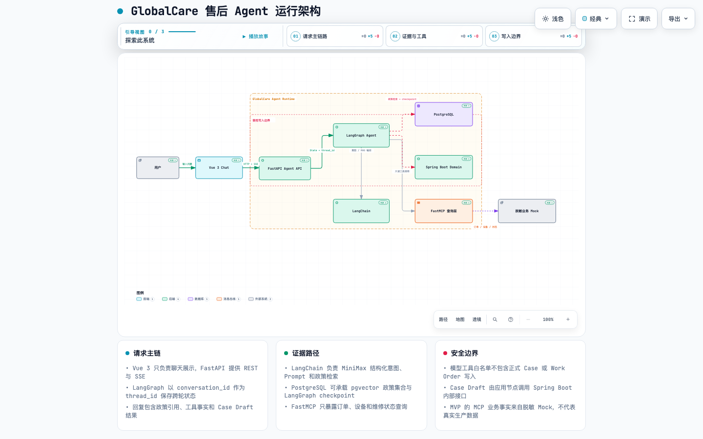
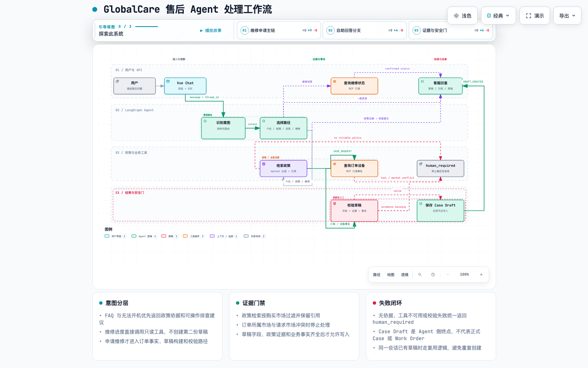
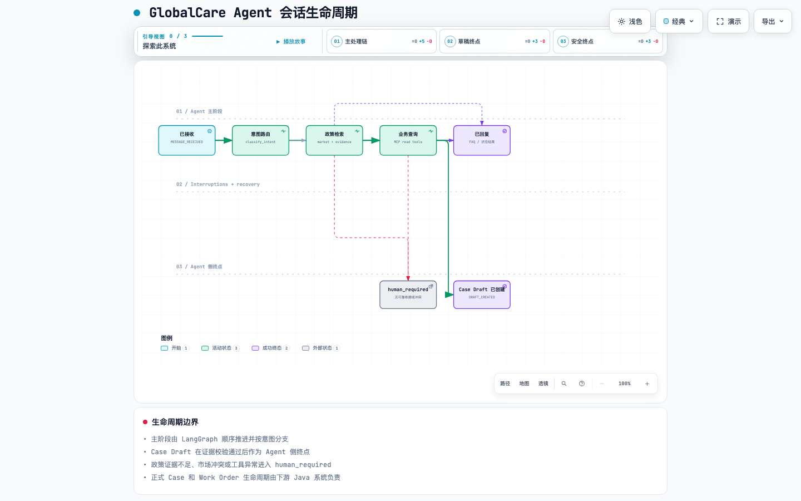
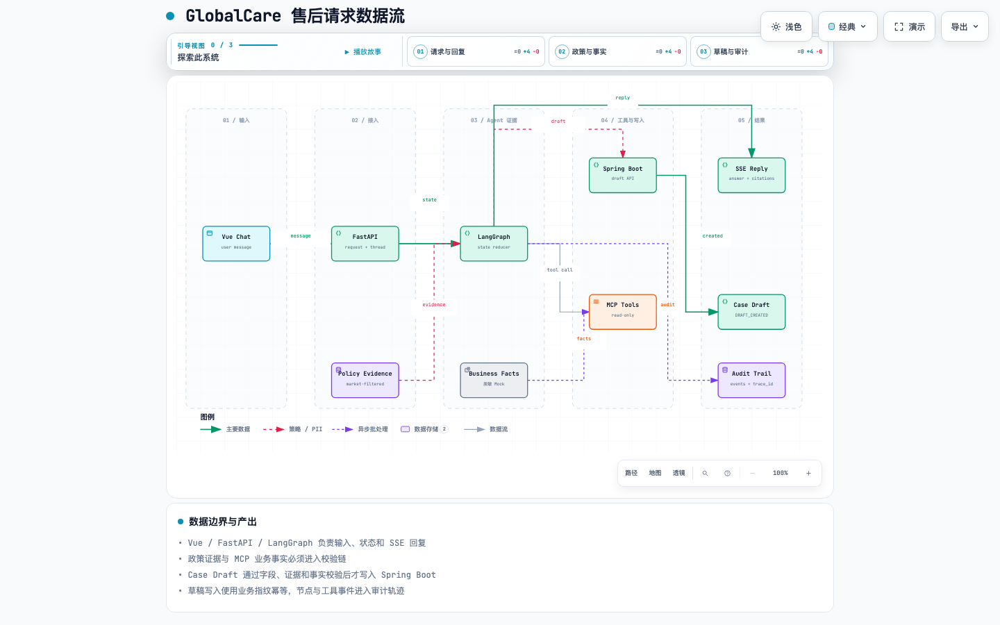
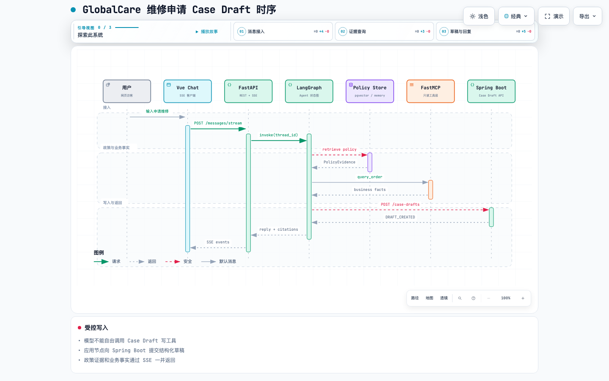
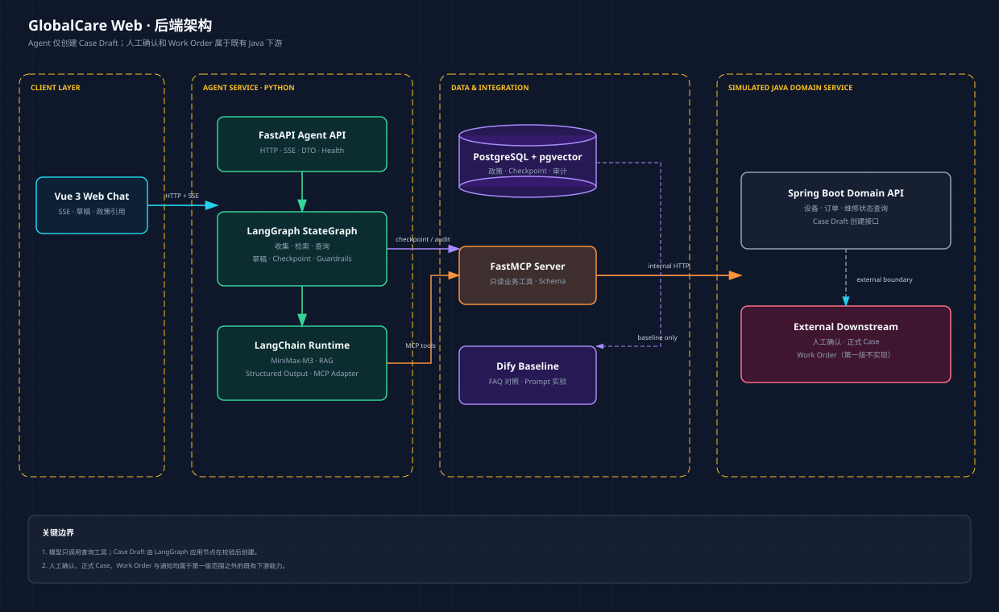
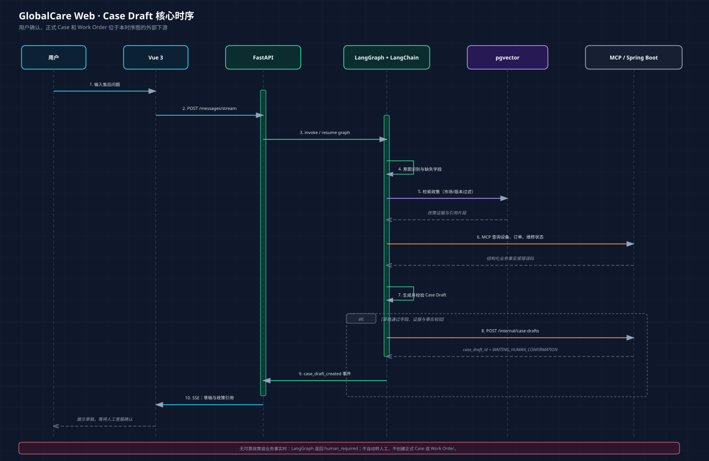
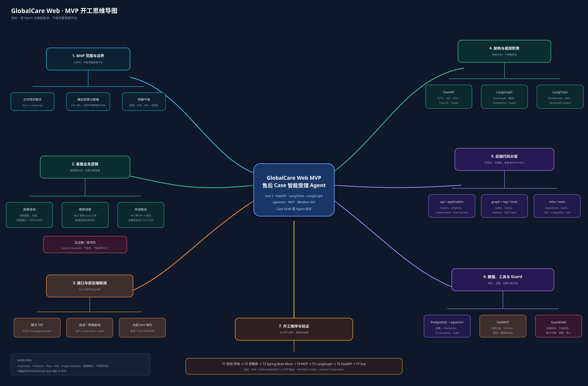

# GlobalCare 商品与售后咨询 Agent 技术方案

## 当前实施范围（2026-10-14，优先于下文历史方案）

### 四层路由架构（2026-10-14 更新，代码权威来源）

路由按精度优先、成本递增的漏斗顺序执行，每层命中即返回，不再往下走：

- **第 0 层（硬编码 SOP 规则）**：`intent.classify_intent()` 确定性关键词匹配，覆盖购买链接、售后链接、维修状态、高风险词强制降级等场景，无外部依赖，延迟接近零。
- **第 1 层（Redis 精确匹配）**：用户问句归一化后取 hash，查 Redis 得到 `(intent_id, faq_group_id, faq_item_id)`；再用 `faq_item_id + goodsid + sales_channel + version` 取答案变体。命中则直接返回，跳过语义检索。
- **第 2 层（Milvus 语义检索）**：先在 `intent_corpus` collection 按向量相似度聚合得到唯一 `intent_id`，再在对应 `faq_group_id` 范围内检索 `faq_question` collection，按 `faq_item_id` 聚合置信度；`goodsid` 和 `sales_channel` 作为标量过滤条件；最终经适用性审查（`UNSUPPORTED_PRODUCT_TERMS` / `UNSUPPORTED_POLICY_TERMS`）才能输出。Embedding 使用本地 BGE-M3（1024 维，`sentence_transformers`），离线测试用确定性 hash。
- **第 3 层（LLM 兜底 + UNKNOWN 话术）**：前三层均未命中时，`AgentModel.classify()` 做最后一次意图识别；仍无法处理则路由到 `UNKNOWN` 意图，输出固定话术，保证系统永远有响应。

知识存储分工：Milvus（`milvus-standalone`，端口 19530，database `ai_customer_service`）承担语义检索；Redis（端口 56379）承担第 1 层精确匹配和答案变体；PostgreSQL（端口 55432）只保留会话/消息/审计/checkpoint，不再做向量检索，`policy_documents` 表已通过 `005_drop_policy_documents.sql` DROP。

知识数据模型：`intent_id`（意图，决定 `route_target` 为 SOP 或 FAQ）→ `faq_group_id`（FAQ 组，限定第 2 层检索范围）→ `faq_item_id`（标准问，挂相似问法）。问题身份与产品无关；答案变体按 `faq_item_id + goodsid + sales_channel + version` 区分。政策 Markdown 仍为编写源，由 `scripts/seed_milvus_redis.py` 拆分后写入 Milvus 与 Redis。不保留整段政策 RAG 兜底，未命中直接进入第 3 层。

### 中国大陆单市场实现（本轮代码调整）

当前客服仅服务中国大陆。内部保留 `market=CN` 兼容现有政策元数据和存储结构；接口默认 CN，不接受其他国家，页面和对话不再选择、抽取或追问国家。政策按固定 CN 加三级品类 goodsid、销售渠道匹配。删除海外政策和运行样例，独立 Java/MCP 查询样例统一为大陆数据。

本轮不接入 MCP 自动订单查询，不新增数据库表或改写历史数据。既有海外会话不再参与新咨询，应新建大陆会话；下文涉及多国家的内容仅为历史设计。

### 最新目标交互：本轮仅改 PPT 与方案

客户只用自然语言描述问题，不输入订单号、国家、三级品类 goodsid 或销售渠道。涉及政策时，输出前由系统自动通过 MCP 获得可信订单信息、关联政策或政策适用条件，再完成末端适用性审查。当前订单绑定和查询实现属于业务侧能力，答辩不展开。适用性校验代码本轮不扩展，现有运行代码与目标交互的差异留待后续集成。

两张用户参考图用于说明企业整体架构和分层路由。本项目实现四层路由（含 Redis 精确匹配与 Milvus 语义检索）；Neo4j、推荐、质检或培训平台不归为已实现或个人交付。

- 用户明确购买或申请售后时，返回固定话术及已配置的官网商城/售后申请 URL；纯咨询根据知识证据回答，否定办理不触发入口。
- 草稿业务完全退出：移除构建、校验、创建、复用节点、接口、事件、存储读写及 Java 草稿端点。既有数据库历史记录不执行破坏性删除。
- 政策内部唯一匹配键为 `market + goodsid + sales_channel`，其中 market 固定 CN。`goodsid` 按本项目业务约定表示三级品类，SKU 为商品规格标识；政策不按型号、地区、购买/申请日期过滤。
- 同一组合只能配置一份政策；国家固定 CN，品类和渠道是系统内部适用条件，由订单和关联政策提供，不作为客户表单或对话追问项。无法可靠关联时说明限制，不要求客户重新填写后台字段。商品参数咨询可保留具体商品/型号上下文，但不参与政策匹配。
- 复用会话 PostgreSQL、checkpoint、消息幂等和审计；知识检索迁移到 Milvus + Redis，不新增 PostgreSQL knowledge_* 表、知识发布快照或费用账本。
- 完整知识存储与发布模块保留为整体架构规划，由系统配套承担；本人开发范围是 Agent 路由、检索集成、官方入口、接口和结果展示，不将配套模块表述为本轮个人交付。
- dense/sparse、RRF、独立重排、父章节回查和 token 上下文预算仍属于后续 RAG 设计，实施以实际代码和验证为准。当前政策正文保存在文件及现有检索后端，长文档父块回查可先由文档 ID 关联原文件，不以新增 PG 知识表为前提。
- 品类编码和三渠道按项目约定定义，正式官方 URL 与业务侧订单接口仍待提供；现有政策资料仅用于回归样例，不代表正式品牌政策。

下文为历史实施记录，不再作为草稿业务、新政策过滤或本轮开发范围的依据。

> 版本：v1.8（Agent 生产关键能力改造；最终代码与验收见 [PR 报告](docs/review/README.md)）
> 日期：2026-08-30  
> 状态：MVP 核心链路已编码并完成离线、HTTP、浏览器联调；MiniMax-M3 最小真实结构化 smoke 已通过  
> 定位：面向全球消费电子售后场景的企业级 Agent 服务原型。业务数据、政策和 Java 服务使用模拟实现。

## 本轮改造契约（2026-10-01）

本轮已实现 JWT 隔离、PostgreSQL 会话/消息/审计/幂等结果、草稿写入账本、执行前预算、严格政策检索、业务事实/回执校验、生产门禁、readiness、故障注入和 CI。最新代码三轮完整回归每轮 247 项通过，共 741 次执行；真实公司身份/业务/模型与生产发布未在本环境验收。下文原 MVP 图示及配置章节为历史/默认开发模式，发生差异时以 PR 报告中的当前实现、源码和测试为准。

本轮只改 Agent 服务；不引入新平台、多 Agent、正式工单或坐席系统。采用已有 PyJWT 接入现有登录系统的 RS256 JWT，不自行签发生产登录凭证。JWT 必须包含可信 issuer/audience、有效期、用户、租户和客户身份；会话所有权按签名验证后的身份隔离，业务事实另行核验租户/客户归属。

- 增加可选择的 PostgreSQL 会话/消息/草稿/审计/幂等结果存储；不是只保存图 checkpoint。迁移是增量的，先执行迁移再部署，回退可切回旧版本但不能删除新表来假装无数据损失。
- 同会话单轮执行串行化；内存模式为进程内锁，PostgreSQL 为跨实例 advisory lock。相同消息 ID 必须绑定相同有效请求；完成后重放，不重复跑图；锁等待和总运行时间有上限。
- 修复跨意图订单污染和无关请求复用草稿；保留故障摘要；所有业务事实、政策市场和草稿字段均经应用校验。
- MCP 工具发现/调用受超时和调用次数限制；异常响应不能作为有效业务事实；写操作不增加自动重试。
- 严格检索模式不允许 pgvector/Embedding 静默降级；FAQ/排查回复绑定实际政策文本，不把固定 12 个月当所有政策答案。
- 服务错误统一发 error/done；正常完成在结果提交后才发成功完成事件；readiness 检查真实存储和依赖，可返回 503。
- production 启动门禁禁止共享 Demo Token、内存存储/图 checkpoint、Hash Embedding、Mock 模型/网关和不明确的 CORS；这只是必要门禁，不代表真实下游、安全审计、HA/容量和生产上线已验收。
- 增加本地及 CI 的回归、真实 PostgreSQL/pgvector、并发/重启/隔离测试。采用“复现 → 最小修复 → 回归 → 再检查”循环，不以跳过失败测试提高通过率。

生产登录系统的实际 issuer、public key、audience、租户字段映射和真实业务查询服务仍需部署方提供。默认开发模式保留原网页 Demo Token 接口；JWT 模式使用 Authorization: Bearer，不接受客户端自报身份。

## 1. 证据与设计边界

- E-001：毕设说明的智能客服方向要求 LangChain 1.x、LangGraph、RAG、工具调用、多轮对话和可运行 Demo。
- E-002：Harness 讲义要求 Agent 系统解决循环失控、工具错误、状态丢失、上下文膨胀、权限缺失、验证缺失和成本失控等问题。
- E-003：当前学习工作区不是统一构建工程；Python 开发沿用 Conda 环境 ai-base，并分别报告离线、真实模型和 HTTP 验证。
- E-004：已只读核验 langchain/个人/.env：MINIMAX_API_KEY、MINIMAX_BASE_URL 和 MINIMAX_MODEL 均已设置；模型名为 MiniMax-M3。密钥不会写入代码、日志或本文档。

参考材料：

- ai-agent/langchain/project/harness-mvp/大模型开发学员毕设项目布置说明文档（final）.pdf
- ai-agent/langchain/project/harness-mvp/手撕Harness.pdf
- ai-agent/langchain/project/harness-mvp/harness.ipynb

## 2. 项目目标与范围

### 2.1 项目目标

用户在网页聊天中描述售后问题。Agent 收集必要信息、检索订单所属市场的政策、查询设备和订单等业务事实，生成并持久化结构化 Case 草稿。草稿由人工客服在既有人工流程中确认；正式 Case 和 Work Order 属于 Java 下游系统，不在第一版 Agent 实现范围。

核心原则：

1. Agent 可创建低风险 Case 草稿，但不能创建正式 Case 或 Work Order。
2. 草稿创建前必须有完整字段、政策证据和确定性业务查询结果。
3. 人工客服确认和 Java 下游 Work Order 流程被视为外部能力。
4. 哪个国家购买就使用哪个国家的售后政策和售后流程；第一版不做跨国售后判断。
5. AI 客服与传统人工客服是独立通道；第一版只实现 AI 通道。
6. 业务数据可以模拟；Agent 的状态管理、工具约束、审计、验证和测试必须真实实现。

### 2.2 第一版范围

| 分类 | 已确认范围 |
|---|---|
| 产品类型 | 手机 |
| 市场 | 中国（CN）、马来西亚（MY） |
| 语言 | 中文、英文 |
| 渠道 | 网页文字聊天 |
| 数据 | 模拟、脱敏数据 |
| Chat Model | MiniMax-M3 |
| 核心闭环 | Chat → 事实查询/政策检索 → Case Draft → Agent 侧完成 |
| 前端 | Vue 3 + JavaScript，最小聊天页面 |

### 2.3 明确不做

- 语音、图片诊断、视频诊断和电话接入。
- 真实退款、换机、赔偿、支付、ERP 或真实公司接口。
- 正式 Case 确认、Work Order 创建、失败重试和通知。
- 自动转人工、人工客服跳转、人工坐席后台。
- 多 Agent 协作、模型微调和十余个国家的真实政策。
- 使用真实用户、订单、SN、IMEI、地址或公司凭证。

## 3. 业务模型与边界

### 3.1 领域对象

| 对象 | 第一版作用 | 边界 |
|---|---|---|
| Conversation | 一次 AI 客服会话 | Agent 服务内部持久化 |
| Case Draft | Agent 根据事实和政策生成的结构化受理草稿 | Agent 可以创建 |
| Case | 被人工客服确认后的正式受理记录 | 下游 Java 系统负责 |
| Work Order | 由正式 Case 转化的售后执行任务 | 下游 Java 系统负责 |

第一版的 Agent 终点：

~~~text
CASE_DRAFT_CREATED
      ↓
Agent Scope End
~~~

### 3.2 客服通道

~~~text
通道一：AI 智能客服
  Vue 3 → FastAPI → LangGraph Agent

通道二：传统人工客服
  既有外部能力，第一版不实现
~~~

Agent 无法可靠处理时只返回 human_required 提示；不自动转人工、不创建转接记录。

## 4. 总体技术架构

~~~text
┌────────────────────────────┐
│ Vue 3 Web Chat             │
│ 对话 / 政策引用 / 草稿结果  │
└──────────────┬─────────────┘
               │ HTTP + SSE
               ▼
┌────────────────────────────┐
│ FastAPI Agent API          │
│ 会话 / 流式输出 / 草稿查询  │
└──────────────┬─────────────┘
               ▼
┌────────────────────────────┐
│ LangGraph After-Sales Graph│
│ 状态机 / 路由 / 恢复 / 审计 │
└───────┬───────────┬────────┘
        │           │
        │           ├── LangChain
        │           │    ├── MiniMax-M3 Chat Model
        │           │    ├── Structured Output
        │           │    ├── RAG Retriever
        │           │    └── MCP Tool Adapter
        │           │
        │           ├── PostgreSQL + pgvector
        │           │    ├── 政策知识库
        │           │    ├── LangGraph Checkpoint
        │           │    └── 审计日志
        │           │
        │           └── MCP Client
        │                 ↓
        │             FastMCP Tool Server
        │                 ↓
        │             Spring Boot 模拟业务查询与草稿接口
        │
        └── Dify FAQ Baseline（独立对照，不在主链路）
~~~

### 4.1 Archify 可交互总体架构图

下图基于当前仓库中的 Vue、FastAPI、LangGraph、LangChain、PostgreSQL/pgvector、FastMCP 和 Spring Boot 实现生成，并绑定当前 Git 提交的源码路径证据。

[打开可交互 HTML](diagram/archify/globalcare-architecture.html) · [查看 JSON 规格](diagram/archify/globalcare-architecture.json) · [查看视觉检查报告](diagram/archify/globalcare-architecture.visual-check.html)

## 5. 组件职责

| 组件 | 技术 | 职责 | 不负责 |
|---|---|---|---|
| 前端 | Vue 3 + JavaScript | 聊天、流式显示、政策引用、草稿结果 | 业务判断、直连 MCP |
| Agent API | FastAPI | 会话入口、SSE、草稿查询、健康检查 | 下游 Java Work Order 事务 |
| Agent 编排 | LangGraph | 状态机、路由、恢复、最大轮次 | 替代业务规则 |
| 模型能力 | LangChain + MiniMax-M3 | Prompt、结构化输出、RAG、工具适配 | 决定正式写操作 |
| 知识库 | PostgreSQL + pgvector | 政策检索、市场和版本过滤 | 订单和设备事实来源 |
| 工具层 | FastMCP + MCP Client | 受控查询业务事实 | 向模型暴露正式写操作 |
| 业务服务 | Spring Boot | 模拟查询接口、Case Draft 接口 | 自然语言理解 |
| 基线 | Dify | FAQ 对照、Prompt 实验 | Agent 状态、Case Draft 主流程 |

## 6. LangGraph 状态机

### 6.1 State

~~~python
class AfterSalesState(TypedDict):
    messages: list
    conversation_id: str

    market: str | None
    language: str | None
    intent: str | None

    customer_id: str | None
    order_id: str | None
    serial_number: str | None
    product_model: str | None

    customer_context: dict | None
    policy_evidence: list[dict]
    business_results: list[dict]

    case_draft: dict | None
    case_draft_id: str | None

    retry_count: int
    final_response: str | None
~~~

### 6.2 状态流

~~~text
AI_ACTIVE
      ↓
COLLECTING_INFO
      ↓
CONTEXT_READY
      ↓
RETRIEVING_POLICY
      ↓
QUERYING_BUSINESS_DATA
      ↓
BUILDING_CASE_DRAFT
      ├── 信息不足 → COLLECTING_INFO
      ├── 无可靠依据 → AI_CANNOT_RESOLVE
      └── 草稿合格 → CREATING_CASE_DRAFT
                              ↓
                        CASE_DRAFT_CREATED
                         Agent Scope End
~~~

### 6.2.1 Agent 业务处理工作流图

该图把 FAQ、故障排查、维修进度和维修申请拆成不同分支，展示政策证据门禁、只读 MCP 查询、Case Draft 校验、幂等写入和 `human_required` 安全终点。

[打开可交互 HTML](diagram/archify/globalcare-workflow.html) · [查看 JSON 规格](diagram/archify/globalcare-workflow.json) · [查看视觉检查报告](diagram/archify/globalcare-workflow.visual-check.html)

### 6.2.2 Agent 会话生命周期图

该图强调一次 Agent 运行的主阶段，以及正常回复、`CASE_DRAFT_CREATED` 和 `human_required` 三类结果边界。正式 Case 与 Work Order 的生命周期仍属于下游 Java 系统。

[打开可交互 HTML](diagram/archify/globalcare-lifecycle.html) · [查看 JSON 规格](diagram/archify/globalcare-lifecycle.json) · [查看视觉检查报告](diagram/archify/globalcare-lifecycle.visual-check.html)

### 6.3 节点职责

| 节点 | 输入 | 输出 | 关键约束 |
|---|---|---|---|
| classify_intent | 用户消息 | intent、market、缺失字段 | 结构化输出校验 |
| collect_info | 对话和缺失字段 | 已补全字段 | 一次只追问必要信息 |
| retrieve_policy | 市场、语言、产品、问题 | 政策证据 | 必须 metadata 过滤 |
| query_business | SN、订单号、Case 号 | 业务事实 | 只读 MCP 工具 |
| build_case_draft | 事实、证据、问题 | Case Draft | 不调用正式写接口 |
| validate_draft | 草稿、政策、工具结果 | valid 或 invalid | 确定性字段和证据校验 |
| create_case_draft | 已校验草稿 | case_draft_id | 应用节点调用适配器，不由模型自由调用 |
| render_response | 最终状态 | 用户可读回复 | 必须带证据或明确无依据 |

## 7. LangChain 与 MiniMax-M3

### 7.1 已确认模型配置

已只读核验本机配置：

~~~text
MINIMAX_API_KEY：已设置
MINIMAX_BASE_URL：已设置
MINIMAX_MODEL：MiniMax-M3
~~~

已执行一条最小真实 API Smoke：M3 首选结构化解析返回思考文本和 fenced JSON，受控提取器完成 JSON/语言别名归一化后通过 `IntentDecision` 校验；该请求会消耗 MiniMax 配额，后续回归默认仍使用 mock。

### 7.2 第一版意图

~~~text
PRODUCT_FAQ
WARRANTY_CHECK
REPAIR_STATUS
CASE_REQUEST
~~~

### 7.3 结构化 Case Draft

~~~json
{
  "issue_category": "cannot_power_on",
  "issue_summary": "设备无法开机",
  "suggested_resolution": "repair",
  "market": "MY",
  "missing_fields": [],
  "confidence": 0.92
}
~~~

草稿是模型输出。只有经过字段、政策和查询事实验证后，应用节点才可持久化它。

### 7.4 RAG 回答约束

每条政策结论至少包含：

~~~text
政策名称
政策版本
适用市场
引用片段
~~~

无可靠证据时不生成确定性承诺。

## 8. pgvector 政策知识库

### 8.1 数据源

~~~text
中国手机保修政策（模拟）
马来西亚手机保修政策（模拟）
维修材料要求
电池安全规范
常见故障 FAQ
~~~

所有政策均应在 README 中标注为模拟数据，除非后续引入可公开引用的官方资料。

### 8.2 元数据

~~~json
{
  "market": "MY",
  "language": "en-MY",
  "product_type": "phone",
  "policy_type": "warranty",
  "policy_version": "MY-WARRANTY-2026-01",
  "effective_from": "2026-01-01",
  "effective_to": null,
  "approval_status": "APPROVED"
}
~~~

### 8.3 强制过滤

~~~text
market
language
product_type
policy_type
effective_at
approval_status = APPROVED
~~~

### 8.4 售后请求数据流图

该图展示用户消息、会话状态、政策证据、业务事实、Case Draft 和审计事件如何在系统中流转，同时保留模型只读工具与应用写入的权限边界。

[打开可交互 HTML](diagram/archify/globalcare-dataflow.html) · [查看 JSON 规格](diagram/archify/globalcare-dataflow.json) · [查看视觉检查报告](diagram/archify/globalcare-dataflow.visual-check.html)

## 9. MCP 工具层

### 9.1 模型可见工具

~~~text
get_customer_context
get_device_info
get_order_info
check_warranty
get_repair_status
search_service_center
~~~

### 9.2 模型不可见命令

~~~text
create_case_draft
confirm_case
create_work_order
refund
exchange
compensation
~~~

规则：模型可以查询；Case Draft 创建由 LangGraph 的应用节点在校验后调用；正式 Case、Work Order 和高风险操作都不属于 Agent 第一版。

### 9.3 工具返回协议

成功：

~~~json
{
  "success": true,
  "code": "DEVICE_FOUND",
  "data": {},
  "trace_id": "trace-001"
}
~~~

失败：

~~~json
{
  "success": false,
  "code": "ORDER_NOT_FOUND",
  "message": "未找到对应订单",
  "retryable": false,
  "trace_id": "trace-002"
}
~~~

MCP 工具异常必须结构化返回，不能静默吞掉。

## 10. Spring Boot 模拟业务服务

### 10.1 拟议内部接口

~~~text
GET  /internal/customers/{customerId}
GET  /internal/devices/{serialNumber}
GET  /internal/orders/{orderId}
GET  /internal/repair-cases/{caseId}
GET  /internal/service-centers

POST /internal/case-drafts
GET  /internal/case-drafts/{caseDraftId}
~~~

上述接口为项目内部模拟契约。当前未提供真实 Java 系统接口文档，不能声称接口与原公司系统兼容。

### 10.2 Case Draft 创建条件

~~~text
必填字段完整
查询工具返回事实有效
政策证据存在
草稿通过确定性校验
不存在相同会话和内容指纹的草稿
~~~

草稿状态：

~~~text
DRAFT_CREATED
~~~

人工确认、正式 Case 创建和 Work Order 转换为下游 Java 系统能力，不在本项目实现；如需记录，可在下游系统使用独立的 review_required 元数据，不作为 AI 客服对外状态。

### 10.3 Case Draft 端到端时序图

该图选取“用户申请维修”的代表性链路，展示 Vue → FastAPI → LangGraph → Policy Store/MCP → Spring Boot → SSE 的调用顺序。MCP 内部的脱敏 Mock 被折叠在 FastMCP 参与者中，避免时序图过度拥挤。

[打开可交互 HTML](diagram/archify/globalcare-sequence.html) · [查看 JSON 规格](diagram/archify/globalcare-sequence.json) · [查看视觉检查报告](diagram/archify/globalcare-sequence.visual-check.html)

## 11. FastAPI 与 Vue 3

### 11.1 Vue 3 页面

第一版仅需要：

~~~text
聊天消息列表
流式回复
政策引用卡片
Case Draft 结果卡片
AI 无法处理提示
开发模式 Agent Trace 面板
~~~

Vue 3 使用 JavaScript。前端不是第一版重点；可使用最小静态页面或最小构建方式，但不得阻塞 Agent 服务的实现和验证。

### 11.2 FastAPI 接口

~~~text
POST /api/v1/conversations
POST /api/v1/conversations/{conversationId}/messages/stream
GET  /api/v1/conversations/{conversationId}
GET  /api/v1/conversations/{conversationId}/audit
GET  /api/v1/case-drafts/{caseDraftId}
GET  /healthz
GET  /readyz
~~~

流式事件：

~~~text
status
token
tool_call
policy_evidence
case_draft_created
human_required
error
done
~~~

前端只能调用 FastAPI，不得直接访问 MCP 或 Spring Boot。

## 12. Dify FAQ Baseline（第二阶段，未在 MVP 开通）

建立独立应用 GlobalCare FAQ Baseline，用于：

- 导入与 LangGraph 相同来源的政策 Markdown。
- 验证基础 FAQ 问答效果。
- 对比 Dify 和 LangChain + pgvector 的检索和回答。
- 进行 Prompt 实验。

Dify 不维护 Conversation、Case Draft、人工确认或下游 Work Order 状态。为避免把 MVP 扩大为双运行时系统，本轮只保证政策 Markdown 可复用；Dify 应用配置和效果对比放在第二阶段。

## 13. 数据表

~~~text
conversations
case_drafts
policy_documents
policy_chunks
langgraph_checkpoints
agent_runs
tool_call_logs
audit_logs
~~~

| 层 | 主要表 | 作用 |
|---|---|---|
| 草稿业务 | case_drafts | 已校验、待人工确认的 Case Draft |
| 知识 | policy_documents、policy_chunks | RAG 与版本治理 |
| Agent | conversations、langgraph_checkpoints、agent_runs | 对话、状态恢复、运行轨迹 |
| 审计 | tool_call_logs、audit_logs | 工具调用、节点事件和错误记录 |

## 14. Harness 机制落地

| Harness 机制 | 项目实现 |
|---|---|
| Agent Loop | LangGraph 图、最大工具轮次、超时 |
| Tool Use | LangChain Tool Schema + MCP |
| Progress Tracking | Agent Trace、Case Draft 事件、审计日志 |
| Context Management | 对话历史与 Case 事实分离、历史摘要 |
| Verification Loop | 政策证据、字段和业务事实校验 |
| Permission Gate | 模型只读工具、应用节点创建草稿 |
| Hooks | 模型、工具、草稿状态事件 |
| Token Budget | 单会话 Token 与成本上限 |
| Human Handoff | 只返回 human_required，不主动转接 |
| Feature List | 第一版不单独实现 |
| Subagents | 第一版不实现 |
| Generator-Evaluator | 离线评估回复质量 |

不复制 Harness 的纯 Python Agent Loop；使用 LangGraph 承载状态和流程，将 Harness 的可靠性原则迁移到应用设计中。

## 15. 可靠性、安全与审计

### 15.1 可靠性

- 每个工具调用设置超时、有限重试和错误分类。
- 工具错误必须返回结构化结果，允许 Agent 修正查询参数。
- 设置最大工具轮次、最大节点次数和单会话 Token 预算。
- Case Draft 创建使用会话和内容指纹保证幂等。
- Case Draft 创建失败时保留会话状态，不丢失已收集字段。

### 15.2 安全

- 只使用脱敏模拟数据。
- 模型没有正式 Case、Work Order、退款和换机写权限。
- Case Draft 创建前重新校验字段完整性、政策证据和工具结果。
- 敏感字段在日志和前端展示时脱敏。
- 工具结果和知识库文档均作为不可信输入处理，不允许覆盖系统指令。
- API Key、数据库账号通过环境变量或凭证管理配置。

### 15.3 审计字段

~~~text
trace_id
conversation_id
agent_run_id
graph_node
tool_name
tool_arguments_masked
tool_result_code
policy_version
case_draft_id
draft_fingerprint
created_at
~~~

## 16. 验收标准

| ID | 验收内容 |
|---|---|
| AC-001 | FAQ 回答包含政策引用和版本 |
| AC-002 | 按订单所属市场隔离 CN 与 MY 政策，不能跨市场引用 |
| AC-003 | 缺少订单号或 SN 时，Agent 主动追问 |
| AC-004 | Agent 通过 MCP 查询设备、订单和维修状态 |
| AC-005 | Agent 只能生成结构化 Case Draft，不能创建正式 Case 或 Work Order |
| AC-006 | 通过字段、证据和业务事实校验后，应用节点创建 Case Draft |
| AC-007 | Case Draft 被持久化为 DRAFT_CREATED 状态，Agent 侧流程结束 |
| AC-008 | 相同会话的重复请求不会生成重复草稿 |
| AC-009 | 无可靠证据时 Agent 不给确定性承诺，只返回 human_required |
| AC-010 | 模型调用写工具时被 Permission Gate 拦截 |
| AC-011 | Agent 达最大轮次或预算后优雅停止 |
| AC-012 | 能查询 Agent、工具、政策和 Case Draft 审计轨迹 |
| AC-013（第二阶段） | Dify 基线与 LangGraph 使用相同来源的政策样本 |

## 17. 测试方案

### 17.1 单元测试

- 意图分类路由。
- Case Draft 状态转换。
- 政策 metadata 过滤。
- 草稿字段完整性。
- 工具错误规范化。
- 草稿幂等指纹。
- 权限门控。
- 最大轮次和预算门控。

### 17.2 集成测试

~~~text
LangGraph → MCP → Spring Boot 查询接口
LangGraph 应用节点 → Spring Boot Case Draft 接口
LangChain → pgvector
FastAPI → LangGraph
~~~

### 17.3 端到端 Golden Conversation

至少准备 30 条，覆盖：

~~~text
正常 FAQ
CN/MY 政策隔离
按订单所属市场选择政策
缺少信息
订单不存在
维修状态查询
Case Draft 创建
重复草稿请求
无政策证据
工具超时
Prompt Injection
多会话隔离
~~~

没有实际测量前，不在 README、简历或 PPT 中填写准确率、效率提升比例等数字。

## 18. 实施任务 DAG

| 任务 | 内容 | 依赖 | 验收映射 |
|---|---|---|---|
| T1 | 冻结 Case Draft 状态、字段和指纹规则 | 无 | AC-005 至 AC-008 |
| T2 | 初始化 PostgreSQL、pgvector、模拟政策数据 | T1 | AC-001、AC-002 |
| T3 | 实现 Spring Boot 查询和 Case Draft API | T1、T2 | AC-006、AC-007 |
| T4 | 实现 FastMCP 查询工具 | T3 | AC-004、AC-010 |
| T5 | 实现 LangChain RAG、结构化输出、MiniMax 模型工厂 | T2 | AC-001 至 AC-003 |
| T6 | 实现 LangGraph 主状态机和 Checkpoint | T4、T5 | AC-003、AC-005、AC-009、AC-011 |
| T7 | 实现 FastAPI SSE 和草稿查询接口 | T6 | AC-006、AC-012 |
| T8 | 实现 Vue 3 最小聊天页面 | T7 | AC-001、AC-007、AC-009 |
| T9（第二阶段） | 建立 Dify FAQ 基线 | T2 | AC-013 |
| T10 | 完成单元、集成、端到端测试 | T2 至 T8 | MVP AC-001 至 AC-012 |
| T11 | README、架构图、PPT、演示材料 | T10 | 面试交付 |

可并行：

~~~text
T3 Spring Boot
T5 LangChain RAG
~~~

## 19. 影响分析与风险护栏

| 维度 | 影响对象 | 风险 | 缓解措施 |
|---|---|---|---|
| 调用链 | Vue、FastAPI、LangGraph、MCP、Spring Boot | 中 | API 契约、SSE 协议、Trace ID |
| 数据库 | Case Draft、向量库、Checkpoint | 高 | 状态枚举、草稿指纹、迁移、备份策略 |
| 接口 | FastAPI 与 Spring Boot 内部接口 | 高 | DTO 校验、错误码、超时、幂等 |
| 运行成本 | MiniMax-M3、Embedding、Dify | 中 | Token Budget、最大步骤、离线测试优先 |
| 数据安全 | SN、订单、设备信息 | 高 | 模拟数据、脱敏、日志过滤 |
| 外部下游 | 人工确认、正式 Case、Work Order | 中 | 明确边界，不在 Agent 侧假装已实现 |

护栏：

~~~text
AGENT_ENABLED：可关闭 Agent 路由
最大工具轮次：防止循环
单会话预算：防止成本失控
只读模型工具：防止越权写操作
Case Draft 校验：防止低质量草稿落库
草稿指纹：防止重复创建
无证据拒答：防止政策幻觉
~~~

## 20. 客观企业级自评

本评分评估当前 Agent 侧设计，不代表已实现质量。

| 维度 | 得分 | 评语 |
|---|---:|---|
| 业务受理流程匹配 | 15/20 | Case Draft 边界清晰，后续正式 Case/Work Order 为外部下游 |
| Agent 流程设计 | 17/20 | 状态、草稿、验证和失败路径较清晰 |
| RAG 与政策治理 | 11/15 | 已有市场隔离和版本，政策审核机制仍待细化 |
| 工具与一致性 | 10/15 | 查询工具清晰，真实 Java 契约尚未验证 |
| 安全与权限 | 7/15 | 模型写权限受限，但真实身份认证和 PII 策略未实现 |
| 可观测与评估 | 8/10 | Trace、审计、Golden Conversation 已定义 |
| 部署与运维 | 3/5 | 可做最小部署，未设计高可用与备份 |
| 一月可交付性 | 5/5 | 范围可控，聚焦 Agent |
| 总分 | 76/100 | Agent 侧适合求职作品，不能宣称下游企业链路已真实上线 |

辅助判断：

~~~text
Agent 侧求职展示价值：90/100
一个月交付可行性：88/100
真实企业生产就绪度：55/100
~~~

## 21. 已确认决策与后续问题

已确认：

1. 使用脱敏模拟数据和简单 Demo Token，不实现真实登录。
2. 前端采用 Vue 3 + JavaScript，最小化实现，不作为演示重点。
3. 人工客服通道不实现，仅作为外部概念边界。
4. 中国和马来西亚政策使用模拟文档。
5. 模型使用本机已配置的 MiniMax-M3。
6. Work Order 创建和失败处理由既有 Java 下游逻辑负责，不在 Agent 侧实现。

实现状态：

1. Case Draft 由 LangGraph 的受控应用节点调用 Spring Boot 模拟接口创建；写工具未暴露给模型。
2. Vue 使用纯静态 Vue 3 CDN 页面，通过 FastAPI SSE 真实联调。
3. MiniMax-M3 配置保留为可选模式；已完成一条最小真实 API Smoke，后续测试默认不重复消耗额度。

## 22. 变更记录

| 版本 | 日期 | 内容 |
|---|---|---|
| v1.0 | 2026-08-30 | 初始方案，包含自动化和 Work Order 主链路 |
| v1.1 | 2026-08-30 | 删除自动化和 Work Order 实现；改为 Agent 创建 Case Draft，等待人工确认；确定 MiniMax-M3、模拟数据和最小 Vue 范围 |
| v1.2 | 2026-08-30 | 明确订单所属国家即售后国家，删除跨市场售后判断 |
| v1.3 | 2026-08-30 | 补充 GitHub 开源标杆参考规则，明确只借鉴成熟模式，不复制代码或扩大 MVP 范围 |
| v1.4 | 2026-08-30 | 新增项目开工思维导图，汇总 MVP 范围、架构、代码分层、接口、数据、测试和实施顺序 |
| v1.5 | 2026-08-30 | 落地 FastAPI/LangGraph/LangChain/MCP/Spring Boot/Vue/pgvector MVP；新增运行、测试和验证资料 |
| v1.6 | 2026-08-30 | 增加会话审计查询、MiniMax M3 输出归一化、单轮预算修正；将 Dify 对照明确为第二阶段 |
| v1.7 | 2026-08-30 | 加入 Archify 生成的架构图、工作流图、时序图、数据流图和生命周期图，并附交互式 HTML、JSON 规格与视觉检查报告 |

## 附录 A. 后端工程分层

本项目是新建工程，后端按以下职责拆分，禁止将 LangGraph、RAG、MCP 和 HTTP Controller 混在同一文件。

~~~text
agent-service/
├── api/
│   ├── routers/              # FastAPI 路由与 SSE
│   ├── schemas/              # 请求、响应、错误 DTO
│   └── dependencies/         # Demo Token、Trace ID
├── application/
│   ├── conversation_service  # 会话应用服务
│   ├── case_draft_service    # 草稿校验、幂等与创建
│   └── query_service         # 草稿与会话查询
├── graph/
│   ├── state.py              # AfterSalesState
│   ├── graph.py              # StateGraph 装配
│   ├── nodes/                # 分类、检索、查询、草稿节点
│   └── routes.py             # 条件路由与停止条件
├── rag/
│   ├── ingestion.py          # 政策文档入库
│   ├── retriever.py          # pgvector 检索与过滤
│   └── policy_guard.py       # 版本、市场、证据校验
├── tools/
│   ├── mcp_client.py         # MCP Client 生命周期
│   ├── tool_policy.py        # 可见工具、超时、重试与权限
│   └── result_normalizer.py  # 工具结果与错误标准化
├── models/
│   ├── minimax.py            # MiniMax-M3 模型工厂
│   └── structured_output.py  # 意图和 Case Draft Schema
├── repositories/
│   ├── conversation_repo.py
│   ├── case_draft_repo.py
│   └── audit_repo.py
├── observability/
│   ├── tracing.py
│   ├── audit.py
│   └── budget.py
└── tests/
    ├── unit/
    ├── integration/
    └── e2e/
~~~

Spring Boot 模拟服务独立于 Agent 服务：

~~~text
domain-service/
├── controller/               # 内部查询与 Case Draft API
├── service/                  # DTO 校验、草稿指纹与状态写入
├── repository/               # 模拟设备、订单、维修数据
└── model/                    # Request、Response、Enum
~~~

## 附录 B. 后端架构图

图源文件：

- diagram/globalcare-backend-architecture.svg
- diagram/globalcare-backend-architecture@2x.png

## 附录 C. Case Draft 核心时序图

图源文件：

- diagram/globalcare-case-draft-sequence.svg
- diagram/globalcare-case-draft-sequence@2x.png

时序说明：

1. 用户在 Vue 页面输入问题。
2. Vue 调用 FastAPI 的 SSE 消息接口。
3. FastAPI 调用或恢复 LangGraph。
4. LangGraph 使用 LangChain 进行意图识别和字段补全。
5. LangGraph 从 pgvector 检索带市场和版本过滤的政策。
6. LangGraph 通过 MCP 查询 Spring Boot 的设备、订单和维修事实。
7. LangGraph 生成并校验 Case Draft。
8. 应用节点调用 Spring Boot 的 Case Draft 接口创建草稿。
9. FastAPI 将草稿创建事件和政策证据通过 SSE 推给 Vue。
10. Vue 展示草稿，后续人工客服确认不属于第一版。

## 附录 D. 前后端接口文档

### D.1 契约约定

| 项目 | 约定 |
|---|---|
| 编码 | UTF-8 |
| 请求体 | application/json |
| 流式响应 | text/event-stream |
| 时间格式 | ISO-8601，UTC，例如 2026-08-30T12:00:00Z |
| ID 格式 | UUID 字符串，除非特别说明 |
| Demo 鉴权 | X-Demo-Token 请求头，第一版仅用于隔离模拟会话 |
| 追踪标识 | 客户端可传 X-Request-Id；服务端返回 trace_id |
| 前端访问边界 | Vue 只调用 FastAPI；不直接调用 MCP、Spring Boot、PostgreSQL 或 Dify |

统一普通响应：

~~~json
{
  "code": "OK",
  "message": "success",
  "data": {},
  "trace_id": "0e6e5d6a-9b1d-4d53-a8da-0e983533ed72"
}
~~~

统一错误响应：

~~~json
{
  "code": "VALIDATION_ERROR",
  "message": "serial_number 不能为空",
  "retryable": false,
  "trace_id": "0e6e5d6a-9b1d-4d53-a8da-0e983533ed72"
}
~~~

### D.2 创建会话

~~~text
POST /api/v1/conversations
~~~

请求头：

| Header | 类型 | 必填 | 说明 |
|---|---|---:|---|
| X-Demo-Token | string | 是 | 模拟用户身份令牌 |
| X-Request-Id | string | 否 | 客户端请求追踪 ID，最大 64 字符 |

请求体：

| 字段 | 类型 | 必填 | 说明 |
|---|---|---:|---|
| channel | string | 是 | 固定值 WEB_CHAT |
| market | string | 否 | CN 或 MY；未知时由 Agent 后续收集 |
| language | string | 否 | zh-CN 或 en-MY |
| client_session_id | string | 否 | 浏览器本地会话标识，最大 64 字符 |

成功响应 data：

| 字段 | 类型 | 说明 |
|---|---|---|
| conversation_id | string | 服务端生成的 UUID |
| status | string | 初始值为 AI_ACTIVE |
| channel | string | WEB_CHAT |
| market | string or null | 会话默认市场 |
| language | string or null | 会话默认语言 |
| created_at | string | ISO-8601 时间 |

示例：

~~~json
{
  "channel": "WEB_CHAT",
  "market": "MY",
  "language": "zh-CN",
  "client_session_id": "browser-session-001"
}
~~~

### D.3 发送消息并接收 SSE

~~~text
POST /api/v1/conversations/{conversation_id}/messages/stream
~~~

路径参数：

| 字段 | 类型 | 必填 | 说明 |
|---|---|---:|---|
| conversation_id | string | 是 | 创建会话返回的 UUID |

请求头：

| Header | 类型 | 必填 | 说明 |
|---|---|---:|---|
| X-Demo-Token | string | 是 | 必须与会话所属模拟用户一致 |
| X-Request-Id | string | 否 | 客户端请求追踪 ID |

请求体：

| 字段 | 类型 | 必填 | 说明 |
|---|---|---:|---|
| client_message_id | string | 是 | 客户端消息幂等标识，最大 64 字符 |
| message | string | 是 | 用户消息，1 至 2000 字符 |
| market | string | 否 | 会话市场未知时可传入；最终以订单所属市场为准，CN 或 MY |
| language | string | 否 | 仅在用户主动变更语言时传入，zh-CN 或 en-MY |

响应头：

~~~text
Content-Type: text/event-stream
Cache-Control: no-cache
Connection: keep-alive
X-Trace-Id: {trace_id}
~~~

SSE 事件：

| event | data 字段 | 字段类型与说明 |
|---|---|---|
| status | phase、message | string；当前图节点和用户可见状态 |
| token | delta | string；模型增量文本 |
| tool_call | tool_name、status、trace_id | string；工具名、running/success/error、工具追踪 ID |
| policy_evidence | policy_id、title、version、market、excerpt | string；可展示的政策引用 |
| case_draft_created | case_draft_id、status、summary、review_required | string、string、string、boolean；草稿 ID、DRAFT_CREATED、草稿摘要、是否需要下游人工处理 |
| human_required | reason | string；无可靠证据或超出 AI 范围的原因 |
| error | code、message、retryable | string、string、boolean；错误信息 |
| done | status、trace_id | string；最终状态和请求追踪 ID |

case_draft_created 示例：

~~~text
event: case_draft_created
data: {"case_draft_id":"5aaf1768-4e6a-4cc9-a21f-84d6ed37a76b","status":"DRAFT_CREATED","review_required":true,"summary":"设备无法开机，已生成维修受理草稿"}
~~~

前端规则：

1. 收到 token 时按顺序拼接 assistant 消息。
2. 收到 policy_evidence 时更新引用卡片，不拼接进用户输入。
3. 收到 case_draft_created 时展示草稿结果卡片。
4. 收到 human_required 时展示人工客服提示，不主动跳转。
5. 收到 error 后依据 retryable 决定是否显示重试按钮。
6. 收到 done 后结束当前流式请求。

### D.4 查询会话

~~~text
GET /api/v1/conversations/{conversation_id}
~~~

路径参数和鉴权头同 D.3。

成功响应 data：

| 字段 | 类型 | 说明 |
|---|---|---|
| conversation_id | string | 会话 UUID |
| status | string | AI_ACTIVE、CASE_DRAFT_CREATED、AI_CANNOT_RESOLVE、COMPLETED 或 FAILED |
| market | string or null | 订单所属市场，也是售后市场 |
| language | string or null | 当前语言 |
| messages | array | 消息列表 |
| case_draft_id | string or null | 已创建草稿时返回 |
| updated_at | string | ISO-8601 时间 |

messages 数组元素：

| 字段 | 类型 | 说明 |
|---|---|---|
| message_id | string | UUID |
| role | string | user、assistant 或 tool |
| content | string | 可展示文本；工具敏感参数不返回 |
| created_at | string | ISO-8601 时间 |
| citations | array | 政策引用数组，可为空 |

### D.4.1 查询会话审计轨迹

~~~text
GET /api/v1/conversations/{conversation_id}/audit
~~~

路径参数和鉴权头同 D.3。第一版返回当前 Agent 服务进程内的会话审计记录；生产化需要替换为 PostgreSQL 或可观测平台的持久化审计仓储。

成功响应 data 为数组，每个元素：

| 字段 | 类型 | 说明 |
|---|---|---|
| audit_id | string | 审计事件 UUID |
| trace_id | string | 当前请求链路标识 |
| event_type | string | MESSAGE_RECEIVED、GRAPH_NODE_COMPLETED、TOOL_CALL、POLICY_EVIDENCE、CASE_DRAFT_CREATED、AGENT_RUN_COMPLETED 等 |
| event_payload | object | 脱敏后的事件元数据，不包含原始用户消息和工具敏感参数 |
| created_at | string | ISO-8601 时间 |

### D.5 查询 Case Draft

~~~text
GET /api/v1/case-drafts/{case_draft_id}
~~~

路径参数：

| 字段 | 类型 | 必填 | 说明 |
|---|---|---:|---|
| case_draft_id | string | 是 | Case Draft UUID |

请求头：

| Header | 类型 | 必填 | 说明 |
|---|---|---:|---|
| X-Demo-Token | string | 是 | 必须与来源 Conversation 所属模拟用户一致 |
| X-Request-Id | string | 否 | 客户端请求追踪 ID |

成功响应 data：

| 字段 | 类型 | 说明 |
|---|---|---|
| case_draft_id | string | 草稿 UUID |
| status | string | DRAFT_CREATED |
| conversation_id | string | 来源会话 UUID |
| issue_category | string | 故障类别，例如 cannot_power_on |
| issue_summary | string | 用户问题摘要 |
| suggested_resolution | string | 建议处理方式，例如 repair |
| market | string | CN 或 MY |
| product_model | string or null | 产品型号 |
| order_id_masked | string or null | 脱敏订单号 |
| serial_number_masked | string or null | 脱敏 SN |
| missing_fields | array of string | 仍缺失的字段；草稿创建成功时应为空 |
| policy_evidence | array | 政策引用数组 |
| review_required | boolean | 固定为 true，表示下游人工流程可继续处理；不代表当前 AI 页面暂停 |
| created_at | string | ISO-8601 时间 |

### D.6 健康检查

~~~text
GET /healthz
GET /readyz
~~~

healthz 成功响应：

| 字段 | 类型 | 说明 |
|---|---|---|
| status | string | 固定 ok |
| service | string | globalcare-agent |
| version | string | 服务版本 |

readyz 成功响应：

| 字段 | 类型 | 说明 |
|---|---|---|
| status | string | ready 或 not_ready |
| postgres | string | up 或 down |
| pgvector | string | up 或 down |
| mcp | string | up、down 或 degraded |
| model_config | string | configured 或 missing |

### D.7 错误码

| 错误码 | HTTP 状态 | retryable | 说明 |
|---|---:|---:|---|
| VALIDATION_ERROR | 400 | false | 请求字段格式或必填项不合法 |
| UNAUTHORIZED | 401 | false | Demo Token 无效或与会话不匹配 |
| CONVERSATION_NOT_FOUND | 404 | false | 会话不存在 |
| CASE_DRAFT_NOT_FOUND | 404 | false | 草稿不存在 |
| POLICY_NOT_FOUND | 422 | false | 没有可靠政策证据 |
| TOOL_TIMEOUT | 504 | true | MCP 工具调用超时 |
| TOOL_UNAVAILABLE | 503 | true | MCP 或 Spring Boot 不可用 |
| AGENT_LIMIT_EXCEEDED | 429 | true | 最大步骤或工具轮次触发 |
| AGENT_BUDGET_EXCEEDED | 429 | true | 单会话 Token 预算触发 |
| CASE_DRAFT_VALIDATION_FAILED | 422 | false | 草稿未通过字段、证据或事实校验 |
| INTERNAL_ERROR | 500 | false | 未分类服务异常，响应不得泄露内部堆栈 |

### D.8 FastAPI 自动接口文档

服务启动后提供：

~~~text
GET /docs
GET /openapi.json
~~~

Vue 联调以本附录为前置契约，以运行时 OpenAPI 文档为最终接口校验依据。接口字段、错误码或事件类型发生变化时，必须同步更新本技术方案和 OpenAPI Schema。

## 附录 E. 后端与 Spring Boot 内部接口

Spring Boot 接口不面向 Vue。MCP 工具和 LangGraph 应用节点可调用以下内部契约。

### E.1 创建 Case Draft

~~~text
POST /internal/case-drafts
~~~

请求体：

| 字段 | 类型 | 必填 | 说明 |
|---|---|---:|---|
| conversation_id | string | 是 | Agent 会话 UUID |
| source | string | 是 | 固定值 AI_AGENT |
| draft_fingerprint | string | 是 | 由会话和规范化草稿内容生成，用于幂等 |
| market | string | 是 | CN 或 MY |
| language | string | 是 | zh-CN 或 en-MY |
| issue_category | string | 是 | 故障类别 |
| issue_summary | string | 是 | 问题摘要 |
| suggested_resolution | string | 是 | 建议处理方式 |
| customer_context | object | 是 | 已收集的脱敏客户、设备、订单上下文 |
| policy_evidence | array | 是 | 至少一条已审核政策证据 |
| tool_trace_ids | array of string | 是 | 对应工具调用追踪 ID |

成功响应：

| 字段 | 类型 | 说明 |
|---|---|---|
| case_draft_id | string | 草稿 UUID |
| status | string | DRAFT_CREATED |
| created_at | string | ISO-8601 时间 |
| idempotent_replay | boolean | 是否返回已有草稿 |

内部接口错误码：

| 错误码 | 说明 |
|---|---|
| DRAFT_DUPLICATE | 指纹已存在，返回既有草稿 |
| DRAFT_FIELD_INVALID | 草稿字段不完整或格式错误 |
| DRAFT_EVIDENCE_MISSING | 未提供审核通过的政策证据 |
| DOWNSTREAM_UNAVAILABLE | 模拟业务服务不可用 |

## 附录 F. GitHub 开源标杆参考与裁剪规则

以下 Star 数据为 2026-08-30 的 GitHub 快照。Star 数仅用于判断社区采用度和持续维护信号，不等同于可以直接复制或直接适配本项目。

| 参考项目 | 当前 Star | 借鉴内容 | 明确不做 |
|---|---:|---|---|
| [Dify](https://github.com/langgenius/dify) | 约 153.9k | 知识库、Prompt 运营、RAG 基线对照 | 不让 Dify 承担正式 LangGraph 主流程 |
| [LangGraph](https://github.com/langchain-ai/langgraph) | 约 40.7k | 显式状态图、持久化、条件路由、恢复执行 | 不照搬示例，按售后 Case Draft 流程裁剪 |
| [Chatwoot](https://github.com/chatwoot/chatwoot) | 约 36.3k | 客户会话、坐席协同、AI Agent 与 Copilot 分层 | 不复制代码或企业版功能，不做全渠道客服台 |
| [Rasa](https://github.com/RasaHQ/rasa) | 约 21.3k | 意图分流、Fallback、明确的人机交接意图 | 不引入第二套对话运行时 |
| [Frappe Helpdesk](https://github.com/frappe/helpdesk) | 约 3.3k | Case/Ticket、SLA、客户和坐席对象建模 | 不复制 AGPL 代码，不做完整 Helpdesk |
| [Resolver](https://github.com/karankashyap/resolver) | 社区采用度较低 | triage → RAG → grounded draft → guard → escalate-or-suggest、评估与审计 | 仅作为企业化 Agent 模式补充，不以 Star 作为标杆依据 |

### F.1 最终采用的客服 Agent 模式

~~~text
常规 FAQ / 故障排查
→ 直接给出带依据或可操作的答复

维修进度查询
→ 调用查询工具，直接返回状态

申请售后
→ 收集必要字段
→ 查询事实和政策
→ 创建或复用同一份 Case Draft

低置信度 / 无证据 / 高风险
→ 不生成确定性承诺
→ 返回 human_required 提示
→ 不自动转人工、不自动执行正式写操作
~~~

### F.2 参考实现的约束

1. 每个关键模块实现前，优先查阅官方文档和至少一个标杆项目的相同能力。
2. README 或设计文档记录“参考来源、借鉴模式、为何适合本项目、为何不直接复制”。
3. 不复制业务代码、数据、接口、UI 文案或许可证不兼容的实现。
4. 不因为参考项目使用 Redis、消息队列、多 Agent、复杂坐席台，就在 MVP 无业务需要时加入这些组件。
5. 每个借鉴逻辑必须由本项目自己的单元测试、集成测试或端到端测试证明；不得用外部仓库测试结果替代本项目验证。

## 附录 G. 项目开工思维导图

图源文件：

- diagram/globalcare-project-mindmap.svg
- diagram/globalcare-project-mindmap@2x.png

## 23. MVP 实现与验证状态

| 模块 | 实现状态 | 验证边界 |
|---|---|---|
| Vue 3 页面 | 已实现真实 FastAPI SSE 调用 | Computer Use 验证故障排查、市场切换、补单号建草稿、进度查询和高风险拒答；控制台无 error |
| FastAPI | 已实现会话、SSE、草稿查询、CORS、OpenAPI | pytest 与 HTTP E2E 已通过 |
| 审计轨迹 | 已实现会话级 Agent/节点/工具/证据/草稿审计查询 | `GET /conversations/{id}/audit` 经 pytest 与 HTTP E2E 验证；当前为内存仓储 |
| LangGraph | 已实现状态图、信息收集、检索、查询、草稿校验、幂等复用和单轮预算 | 阶段六 162 条用例、3 轮自主循环覆盖关键路由、连续多轮预算、超预算门禁和 MiniMax 输出归一化 |
| LangChain | 已实现 Prompt/结构化 MiniMax 工厂、Document、Embedding 与 Retriever | 默认 Hash Embedding；MiniMax-M3 最小真实 smoke 通过（首选解析失败后进入受控 JSON 归一化） |
| MCP | 已实现 FastMCP 只读工具与 langchain-mcp-adapters Client | HTTP E2E 已经过 MCP 查询订单/维修状态 |
| Spring Boot | 已实现模拟订单、设备、进度和 Case Draft 幂等 API | Maven clean test 与 HTTP 查询已通过 |
| pgvector | 已实现独立 Docker、DDL、政策向量 seed 和检索 | `vector` 扩展、2 条政策、市场过滤和边界负例已真实验证 |
| Checkpointer | Memory 默认；PostgreSQL 可配置 | PostgreSQL `checkpoints` 表已产生 checkpoint 记录 |

当前已知 MVP 边界：会话 REST 仓储和审计查询仍为内存实现；生产化前需补真实身份认证、持久化会话/audit repository、可观测平台、评估集与下游正式契约。Dify FAQ 对照应用是明确的第二阶段，不在本轮 MVP 验收范围。
